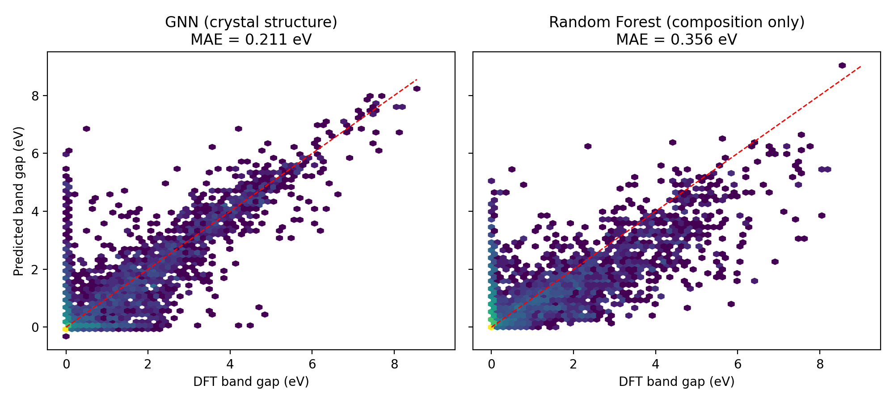

# GNN-Guided Semiconductor Material Discovery

> Crystal-structure-aware graph neural network for predicting semiconductor properties and screening hypothetical materials for target band gaps.

<p align="center">
  
</p>

## Overview

This project develops a **crystal-structure-aware Graph Neural Network (GNN)** for machine-learning-guided semiconductor materials discovery.

Instead of representing a material only by its chemical composition, each material is represented as a **crystal graph**, where:

- atoms are represented as graph nodes,
- interatomic interactions are represented as edges,
- elemental properties are incorporated into node representations,
- neighbor distances are encoded using Gaussian basis functions.

The model performs **multi-task prediction** of electronic, energetic and dielectric properties and is subsequently used to screen hypothetical materials with desirable semiconductor characteristics.

The project also compares the structure-aware GNN against a **composition-only Random Forest baseline** to quantify the value of explicit crystal-structure information.

---

## Key Results

The GNN was evaluated using a **chemical-system-grouped 80/10/10 train/validation/test split**, preventing structures containing the same chemical system from appearing across different splits.

| Property | Unit | Test Samples | GNN MAE | RF MAE | GNN R² | RF R² |
|---|---:|---:|---:|---:|---:|---:|
| OptB88vdW band gap | eV | 8,756 | **0.211** | 0.356 | **0.803** | 0.652 |
| mBJ band gap | eV | 1,928 | **0.368** | 0.691 | **0.837** | 0.574 |
| Formation energy | eV/atom | 8,756 | **0.098** | 0.183 | **0.971** | 0.896 |
| Average electron effective mass | log10(m*/mₑ) | 317 | **0.321** | 0.377 | **0.439** | 0.342 |
| Average hole effective mass | log10(m*/mₑ) | 317 | **0.322** | 0.415 | **0.503** | 0.375 |
| Dielectric constant | log10(ε) | 5,661 | **0.216** | 0.250 | **0.690** | 0.660 |

The effective masses and dielectric constant are evaluated on a log10 scale.

The band-gap model achieves a test MAE of **0.211 eV**, compared with **0.356 eV** for the composition-only Random Forest baseline.

---

## Why a Crystal-Structure GNN?

Composition-only machine-learning models cannot distinguish different crystal structures with the same chemical formula.

This is particularly important for semiconductors because electronic properties can change substantially between polymorphs.

To test this explicitly, the project evaluates materials for which the same chemical formula occurs in multiple structures with band gaps differing by more than 0.3 eV.

### Polymorph test

- Number of test structures: **838**
- GNN MAE: **0.592 eV**
- Composition-only RF MAE: **0.901 eV**

This provides a direct test of whether structural information improves prediction when composition alone is insufficient.

---

## Model Architecture

The model is a compact CGCNN-style architecture implemented using PyTorch Geometric.

### Crystal representation

For each crystal:

```text
Crystal Structure
       │
       ▼
Atomic numbers + elemental properties
       │
       ▼
Crystal graph
       │
       ├── Nodes → atomic representation
       │
       └── Edges → neighbor distances
                    │
                    ▼
             Gaussian distance encoding
                    │
                    ▼
          CGConv message passing × 3
                    │
                    ▼
             Global mean pooling
                    │
                    ▼
                 MLP head
                    │
                    ▼
         Multi-task property prediction
